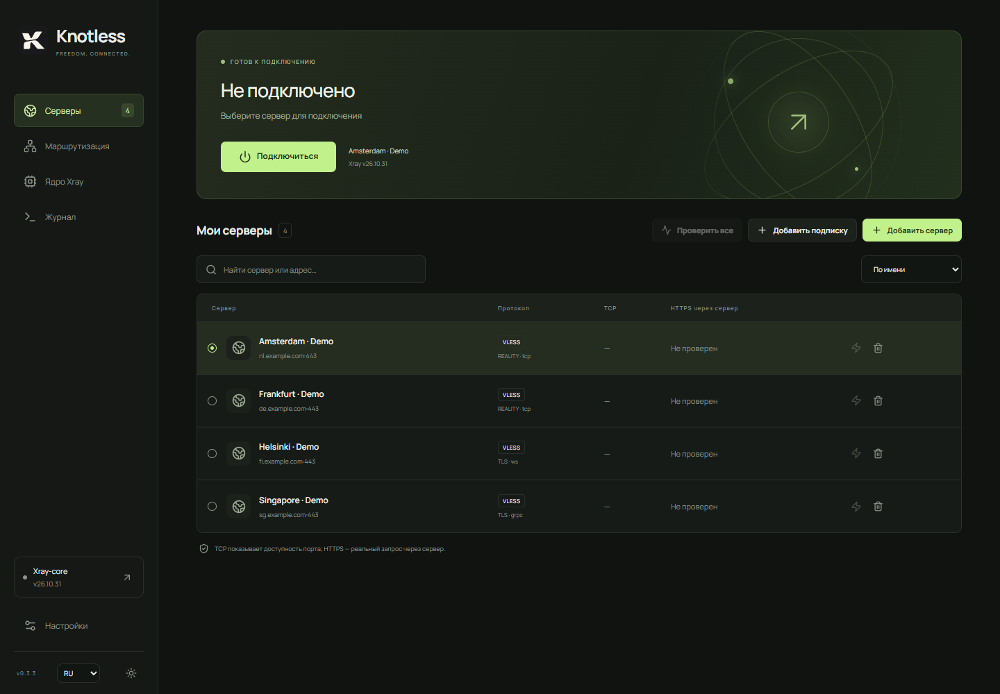

# Knotless

[Русский](README.md) · **English** · [简体中文](README.zh-CN.md)

I wanted my own VPN client because I didn't trust other clients, was tired of waiting for a new client release just to update Xray-core, and really liked RoutingA. That's how Knotless started: a Windows client with independent core version selection and RoutingA-style routing rules.

Built with React / TypeScript and Tauri 2 / Rust. The interface is available in Russian, English and Simplified Chinese.

[Download for Windows x64 or ARM64](https://github.com/rusynergy/Knotless/releases/latest)



The screenshot shows fictional servers on example.com domains. The connection is off and no network tests have been run.

## Features

- Install multiple Xray versions and choose the core independently of client updates.
- TUN mode for device traffic, or local SOCKS5 (`127.0.0.1:10808`) / HTTP (`127.0.0.1:10809`) proxies.
- Basic RoutingA syntax: `default`, `domain`, `ip`, `port`, `network`; actions: `proxy`, `direct`, `block`.
- VLESS with TLS / REALITY; TCP/RAW, WebSocket, gRPC, XHTTP and HTTPUpgrade transports.
- HTTPS subscriptions with standard `x-hwid`, optional per subscription, and manual or scheduled updates.
- Separate TCP latency and HTTPS request tests through the selected server: an open port alone does not prove that the VPN works.
- DNS over TCP or DoH: Quad9 (default), Google, Cloudflare, OpenDNS, Yandex, or a custom resolver.
- Live traffic statistics and graph, connection health checks, optional TUN recovery, tray menu, light and dark themes.

## Version 0.3.7

Knotless requests administrator rights at startup, before opening its window, including after a Windows reboot. TUN no longer needs a separate restart from Settings. Cancelling UAC closes the launcher; an already elevated process does not prompt again.

## Version 0.3.6

DNS settings include “Block DNS outside TUN (WFP)” for compatibility testing. Protection stays enabled by default, including for existing profiles. Disabling it requires saving and reconnecting. DNS inside TUN still uses the selected server, but Windows and other applications may send queries outside the VPN. This is a diagnostic option, not a confirmed fix for ARM64 DNS failures.

## Version 0.3.5

The installer uses a separate shutdown helper. If Knotless is running as administrator for TUN, only the helper requests UAC elevation; installation remains in the original user's profile. New clients receive a graceful exit request. For versions up to 0.3.4, the helper waits for console Xray to shut down and clean up TUN before stopping the exact client instance being updated. If shutdown fails or UAC is cancelled, application files are not replaced.

## Version 0.3.4

Port lists now accept spaces after commas and around range separators. Domain lists compile into separate Xray matchers. Combine different condition types with `&&`, for example: `network(udp) && port(596-599, 1400) -> proxy`.

## Version 0.3.3

The installer updates an existing NSIS installation in place, preserving servers and settings. Both installers include Xray **v26.10.31**, selected automatically on first launch. Each build fetches the latest stable Xray and verifies SHA-256. Installing the bundled core needs no separate download. After a new bundled version has been selected once, subsequent manual selections are preserved.

## Getting started

1. Install the version for your Windows architecture. To update, exit Knotless from its tray menu first.
2. Add your VLESS link or HTTPS subscription, then select a server.
3. Run the server check: TCP tests port connectivity; HTTPS sends a request through the server.
4. Choose local proxy mode or TUN in Settings. Knotless requests administrator privileges at startup, so TUN needs no separate restart.
5. Connect. In local proxy mode, configure the proxy in your browser or other application.

TUN respects routing rules. Use `default: proxy` for internet traffic through the server; `direct` bypasses the proxy and `block` blocks matching traffic. Rules and DNS changes apply on the next connection.

```text
default: proxy
ip(geoip:private) -> direct
ip(91.108.56.0/22, 149.154.160.0/20) -> proxy
domain(domain: example.com) -> proxy
domain(geosite:category-ads) -> block
```

## Development and builds

Requires Node.js 22+, Rust MSVC, Visual Studio C++ Build Tools and WebView2 Runtime.

```powershell
npm ci
.\scripts\dev.ps1
.\scripts\build.ps1 -Architecture all
```

Use `-Architecture x64` or `-Architecture arm64` for a single architecture. ARM64 also requires the `aarch64-pc-windows-msvc` Rust target, ARM64 MSVC / Windows SDK libraries and Clang in PATH. Builds need access to GitHub to fetch Xray.

Installers are written to `src-tauri/target/release/bundle/nsis/` (x64) and `src-tauri/target/aarch64-pc-windows-msvc/release/bundle/nsis/` (ARM64), or the equivalent under `CARGO_TARGET_DIR`. `npm run dev` previews the UI in a browser; native operations are unavailable there.

```powershell
npm test
npm run build
cargo test --manifest-path src-tauri/Cargo.toml
```

## Current limitations

This is a development release. Installers are unsigned. ARM64 has been cross-compiled and its packaged binaries checked, but has not been tested on ARM hardware. Full RoutingA compatibility, a visual rule editor, Windows autostart, a persistent kill switch, automatic system HTTP proxy configuration and automatic client updates are not implemented.

Profiles and subscription URLs are stored locally without encryption. HTTPS subscriptions do not follow redirects; use the final URL. Subscription updates run while Knotless is running. A successful HTTPS check covers the configured URL at that moment, not all websites, UDP or system routes. IPv6 DNS answers are disabled by default for compatibility; browser-specific DoH can bypass this setting.

Xray cores are stored in `%LOCALAPPDATA%/app.knotless.desktop/cores` (x64) or `cores-arm64` (ARM64). Wintun's distribution license is included in [WINTUN-LICENSE.txt](src-tauri/resources/WINTUN-LICENSE.txt); the bundled Xray package includes its license. Detailed implementation notes and optional integration test commands are available in the [Russian documentation](README.md).
