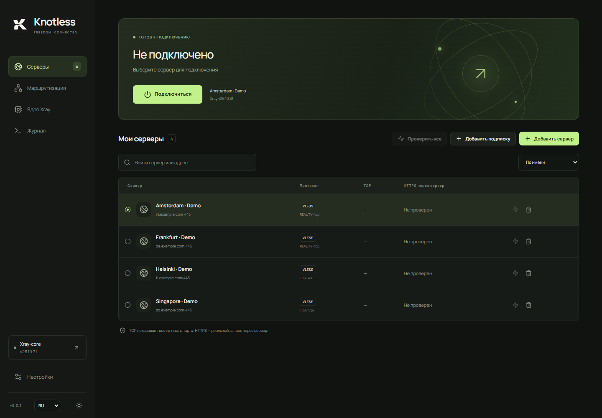

# Knotless

**Русский** · [English](README.en.md) · [简体中文](README.zh-CN.md)

Я захотел свой VPN-клиент, потому что не доверял другим, устал ждать новую версию клиента ради обновления Xray-core и очень люблю RoutingA. Так появился Knotless: клиент для Windows с независимым выбором версии ядра и правилами маршрутизации в стиле RoutingA.

Windows-клиент Xray с интерфейсом на React / TypeScript и нативной частью на Tauri 2 / Rust.

[Скачать для Windows x64 или ARM64](https://github.com/rusynergy/Knotless/releases/latest)



Главный экран с вымышленными серверами на доменах example.com. Соединение отключено, сетевые тесты не запускались.

## Текущая версия: 0.3.9

При первом запуске выбран TUN. Обновление сохраняет уже выбранный режим. В разделе «Настройки → Фрагментация TCP» можно включить фрагментацию TLS ClientHello или первых трёх записей TCP, задать размер в байтах и задержку в миллисекундах. По умолчанию выключена. Настройки применяются к соединению с VPN-сервером при следующем подключении и при HTTPS-проверке; маршруты direct не изменяются. Требуется Xray v26.10.31 или новее.

## Версия 0.3.8

- Кнопка QR в добавлении сервера включает камеру и переносит распознанную VLESS-ссылку в поле импорта. При нескольких камерах можно выбрать нужную; при отсутствии камеры или запрете доступа остаётся ручной ввод. Камера выключается после распознавания, закрытия сканера или скрытия окна.
- Кнопка «Поделиться» у каждого сервера показывает QR и ссылку, копируемую по клику, в том числе для серверов из подписок. Генерация и чтение QR выполняются локально.
- Версия в интерфейсе теперь берётся из версии пакета.

## Версия 0.3.7

- Knotless запрашивает права администратора сразу при запуске, до открытия окна. Это действует и после перезагрузки Windows: отдельно перезапускать клиент из настроек для TUN больше не нужно. При отмене UAC приложение не открывается. Если процесс уже имеет права администратора, повторного запроса нет.

## Версия 0.3.6

- В настройках DNS добавлен переключатель «Блокировать DNS вне TUN (WFP)» для проверки совместимости. Защита включена по умолчанию, в том числе для старых профилей. Отключение требует сохранения и переподключения; DNS внутри TUN по-прежнему направляется через выбранный сервер, но Windows и другие приложения могут отправлять запросы вне VPN. Это диагностическая возможность, а не подтверждённое исправление DNS на ARM64.

## Версия 0.3.5

- Установщик завершает работающий клиент отдельным помощником. Если Knotless запущен от администратора для TUN, помощник запрашивает UAC; установка остаётся в профиле исходного пользователя.
- Новые версии получают запрос штатного выхода. Для версий 0.3.4 и старше помощник сначала завершает консольный Xray, ожидая очистки TUN, затем закрывает именно обновляемый экземпляр клиента. Если завершение не удалось или UAC отменён, файлы приложения не заменяются.

## Версия 0.3.4

- Исправлены списки портов с пробелами после запятых и вокруг дефиса диапазона.
- Списки доменов компилируются в отдельные условия Xray. Разные типы условий можно объединять через `&&`: `network(udp) && port(596-599, 1400) -> proxy`.

## Версия 0.3.3

- Установщик обновляет существующую NSIS-установку на месте, без страницы выбора удаления, сохраняя настройки и серверы.
- `scripts/build.ps1` загружает последний стабильный Xray на момент сборки, проверяет SHA-256 и включает ядро с geodata в установщик нужной архитектуры. Для сборки нужен доступ к GitHub; для установки ядра интернет не нужен. Новая комплектная версия выбирается один раз; последующий ручной выбор сохраняется.
- Собственный шаблон NSIS основан на Tauri CLI 2.12.4; при обновлении CLI нужно сверять его с upstream.

- Исправлен TCP-замер при включённом TUN: сокет привязывается к интерфейсу исходного маршрута по умолчанию через Windows IP_UNICAST_IF/IPV6_UNICAST_IF. Локальный SYN-ACK TUN больше не считается ответом удалённого сервера. При отсутствии подходящего интерфейса, включённом forwarding/weak-host send или недоступном порте показывается ошибка без обходного замера через TUN.
- TCP измеряет только установление соединения с выбранным портом, без DNS и неудачных попыток других адресов; точность отображения 0,1 мс. Это не ICMP ping. HTTPS по-прежнему отдельно проверяет запрос через сервер. Другой VPN, уже являющийся системным маршрутом по умолчанию, может влиять на прямой TCP-тест.

- Настройки DNS для TUN: Quad9 `9.9.9.9` по умолчанию, Google, Cloudflare, OpenDNS, Yandex и свой IP/DoH URL. Выбор TCP или DoH сохраняется и применяется при следующем подключении, включая подключение из трея и восстановление.
- Совместимость с серверами без IPv6: по умолчанию DNS не выдаёт AAAA и HTTPS-записи (тип 65) с IPv6-подсказками. В настройках можно включить IPv6. Собственный DoH браузера обходит эту фильтрацию; после изменений нужно переподключение и перезапуск браузера. Системный IPv6 не отключается.
- Адаптер TUN использует виртуальный DNS `172.31.255.2`; запросы к нему отправляются выбранному провайдеру через VPN. Это также предотвращает автоматическое переключение браузера на DoH публичного провайдера в обход политики Knotless.
- DoH использует встроенный DNS Xray: A/AAAA, проверка TLS, без незашифрованного резервного сервера. Остальные типы получают пустой ответ. Адрес VPN-сервера разрешается до поднятия TUN, с сохранением TLS SNI и Host транспорта.
- Нативные сборки Windows x64 и ARM64: архитектура Xray и Wintun соответствует приложению.

- Светлая и тёмная темы, поиск и выбор сервера, сортировка по HTTPS-задержке.
- Компактные страницы без верхней панели и рекламных заголовков. Добавление сервера рядом со списком.
- Русский, английский и китайский интерфейс; выбор рядом с темой и в настройках. Меню трея тоже переводится.
- Скорость входящего/исходящего трафика, график последних 60 отсчётов и объём текущего сеанса из счётчиков Xray. Служебные HTTPS-проверки не входят в график.
- HTTPS-подписки с обычным текстом или Base64 VLESS-ссылками. Стандартный `x-hwid`: SHA-256 от идентификатора Windows с префиксом Knotless, стабилен после перезапуска; исходный MachineGuid не передаётся. Отправка HWID отключается для каждой подписки.
- Ручное и фоновое обновление подписок каждые 1–168 часов, включая работу в трее. Ошибки загрузки и неподдерживаемое содержимое не заменяют сохранённый список. Идентификаторы серверов стабильны при обновлении, ручные серверы сохраняются отдельно. Поддерживаемые записи смешанной подписки импортируются с предупреждением об остальных.
- Проверка активного соединения примерно каждые 15 секунд: HTTPS через отдельный локальный SOCKS, принудительно направленный в выбранный сервер; для TUN дополнительно проверяется системный путь. Запущенный процесс больше не считается подтверждением работающего соединения.
- Восстановление TUN после двух неудачных проверок: не чаще одного раза в минуту, до трёх попыток. Можно отключить в настройках. Восстанавливается активный профиль, даже если выбор в списке уже изменён.
- Импорт нескольких VLESS-ссылок; дедупликация конфигураций. TCP/RAW, WebSocket, gRPC, XHTTP и HTTPUpgrade; TLS и REALITY.
- Загрузка официальных Windows x64/ARM64 релизов Xray с проверкой SHA-256, хранение нескольких версий, ручной выбор и откат.
- Предварительная проверка конфигурации выбранным ядром.
- SOCKS5 `127.0.0.1:10808` и HTTP `127.0.0.1:10809`.
- Трей по умолчанию: крестик и сворачивание скрывают окно; левый клик по значку возвращает окно. Правый клик открывает меню «Открыть Knotless», «Подключиться / Отключиться», «Выход». Меню использует выбранный сервер, ядро, сохранённые правила и режим. Состояние контролируется нативно, независимо от таймеров скрытого окна.
- TUN через встроенный inbound Xray (v26.10.31+): IPv4/IPv6, автоматическая привязка outbound к физическому интерфейсу, DNS через сервер. Wintun 0.14.1 включён в установщик; проверены SHA-256 официального архива и Authenticode-подпись DLL.
- Для TUN нужны права администратора; Knotless запрашивает их через обычное окно UAC Windows при запуске. Автоматического подключения после запуска нет.
- TCP-тест отдельно от HTTPS-запроса через конкретный сервер. HTTPS-проверка использует изолированный Xray, не меняет активное подключение, не использует пользовательские правила, не может уйти через `direct`, проверяет TLS и ожидаемый HTTP-статус. Ограничения: 12 секунд на запрос, 1 МБ ответа, не более трёх одновременно работающих тестовых процессов.
- Текстовые правила в базовом синтаксисе RoutingA: `default`, `domain`, `ip`, `port`, `network`; действия `proxy`, `direct`, `block`. Порядок сохраняется; неизвестные конструкции отклоняются.
- Журнал текущего сеанса. Windows Job Object завершает Xray вместе с приложением; конфигурации тестовых процессов удаляются после завершения.

## Запуск разработки

Нужны Node.js 22+, Rust MSVC toolchain, Visual Studio C++ Build Tools и WebView2 Runtime.

```powershell
npm ci
.\scripts\dev.ps1
```

Скрипт автоматически использует Rust из `.tools`, если он установлен в проекте. В другом окружении используется системный `cargo`.

Предпросмотр интерфейса в браузере: `npm run dev`. Нативные операции в браузере недоступны; фиктивных результатов тестов нет.

## Сборка

```powershell
.\scripts\build.ps1
.\scripts\build.ps1 -Architecture arm64
.\scripts\build.ps1 -Architecture all
```

Приложение: `src-tauri/target/release/knotless.exe`. Установщик NSIS: `src-tauri/target/release/bundle/nsis/`.

Для ARM64 нужны Rust target `aarch64-pc-windows-msvc`, библиотеки MSVC/Windows SDK ARM64 и Clang в PATH (для ring). ARM64-результат лежит в `src-tauri/target/aarch64-pc-windows-msvc/release/bundle/nsis/`; если задан CARGO_TARGET_DIR, используется он. ARM64-конфигурация пакует подписанную ARM64 Wintun DLL под стандартным именем `resources/wintun.dll`. На x64-компьютере ARM64-сборка проверяется кросс-компиляцией; запуск требует Windows ARM64.

## Как подключиться

1. Установить Knotless: комплектный Xray уже включён и выбран. Другую версию можно установить на странице «Ядро Xray».
2. Добавить свою VLESS-ссылку в «Серверы».
3. Проверить сервер кнопкой с молнией: TCP показывает доступность порта, HTTPS — успешность запроса через сервер.
4. Выбрать сервер и нажать «Подключиться».
5. В режиме «Локальный прокси» указать SOCKS5 или HTTP-прокси в нужном приложении. Для всего устройства выбрать «Настройки → Режим подключения → TUN» и подключиться. Права администратора запрашиваются при запуске Knotless.

TUN сохраняет ваши правила RoutingA: `direct` по-прежнему означает прямой выход, `block` — блокировку. Для отправки интернет-трафика через сервер используйте `default: proxy`. Настройки режима меняются только при отключённом соединении. DNS-запросы, попавшие в TUN на порт 53, перенаправляются выбранному провайдеру по TCP или DoH через выбранный сервер, перед пользовательскими правилами. Это устраняет отправку исходного адреса домашнего DNS-роутера на удалённый VPN-сервер.

Диагностика состояния сохраняется в `%LOCALAPPDATA%/app.knotless.desktop/connection-health.jsonl` (с ротацией около 128 КБ). Она содержит время, режим и коды успешной/неудачной проверки или восстановления, без ссылок подписок, адресов серверов и ключей. Сырые временные журналы Xray по-прежнему удаляются при завершении процесса.

Подписки допускают только HTTPS и не следуют редиректам: используйте конечную ссылку. Лимиты: 25 секунд, 4 МБ, 5000 записей. Интервальное обновление работает, пока запущен Knotless; автозапуск Windows не добавлен. URL подписок и их содержимое хранятся локально без шифрования в `subscriptions.json`.

Обычное отключение/выход посылает Xray консольное событие завершения и ожидает очистку интерфейса, маршрутов и DNS. При зависании процесс завершается принудительно через 8 секунд. Постоянного kill switch нет: после отключения возвращается обычный доступ в сеть. Полный сетевой тест TUN на этой машине ещё требует запуска с административными правами; проверены конфигурация ядром и механизм штатной остановки Xray.

Успешный тест относится к настроенному URL в момент проверки. Он не гарантирует доступность всех сайтов, UDP или корректность системной маршрутизации. Настройки HTTPS-теста доступны в «Настройках».

Пример маршрутизации:

```text
default: proxy
ip(geoip:private) -> direct
ip(91.108.56.0/22, 149.154.160.0/20) -> proxy
domain(domain: example.com) -> proxy
domain(geosite:category-ads) -> block
port(80,443) -> proxy
network(udp) -> direct
```

Правила начинают действовать при следующем подключении. Перед запуском их дополнительно проверяет Xray, включая доступность GeoIP/Geosite и поддержку полей выбранной версией.

## Проверки

```powershell
npm test
npm run build
cargo test --manifest-path src-tauri/Cargo.toml
```

Опциональный сетевой интеграционный тест использует Xray v26.10.31 и локальный VLESS-сервер. В течение 90 секунд он проверяет HTTPS 204, DNS-перенаправление с фиктивного LAN-резолвера на публичный по TCP через VLESS и настоящие счётчики трафика; затем обнаружение отказа upstream при доступном локальном порте и очистку процесса. Тест не меняет маршруты Windows и не заменяет полную проверку TUN с правами администратора.

```powershell
$env:KNOTLESS_TEST_ROOT = Join-Path (Get-Location) '.tools\integration'
cargo test --manifest-path src-tauri/Cargo.toml real_xray_roundtrip -- --ignored --nocapture
```

Проверка конфигурации TUN самим Xray и штатного завершения скрытого консольного процесса (без изменения маршрутов):

```powershell
$env:KNOTLESS_HELPER_EXE = (Resolve-Path 'src-tauri/target/release/knotless.exe').Path
cargo test --manifest-path src-tauri/Cargo.toml console_shutdown_and_tun_preflight -- --ignored --nocapture
```

Этому тесту нужен Xray v26.10.31 в `$env:KNOTLESS_TEST_ROOT/cores/v26.10.31` и собранный Knotless. Переменная `KNOTLESS_HELPER_EXE` читается только тестовой сборкой.

## Что ещё не реализовано

- Автоматическая настройка системного HTTP-прокси, постоянный kill switch.
- Визуальный редактор и полная совместимость с языком RoutingA.
- Автозапуск, автоматический откат при неудачном переключении версии.
- DPAPI для сохранённых профилей, подписанный установщик и автоматическая загрузка обновлений самого приложения (ручное обновление установщиком поддерживается).

Пока профили с ключами сохраняются в локальном хранилище WebView. Ядра находятся в `%LOCALAPPDATA%/app.knotless.desktop/cores` (x64) или `cores-arm64` (ARM64), временные конфигурации — в соседней папке `runs`. Сам установщик Knotless не подписан. Это версия для разработки и проверки.

Лицензия распространяемой Wintun DLL находится в `src-tauri/resources/WINTUN-LICENSE.txt`. Официальный источник: https://www.wintun.net/; SHA-256 архива 0.14.1: `07c256185d6ee3652e09fa55c0b673e2624b565e02c4b9091c79ca7d2f24ef51`.
