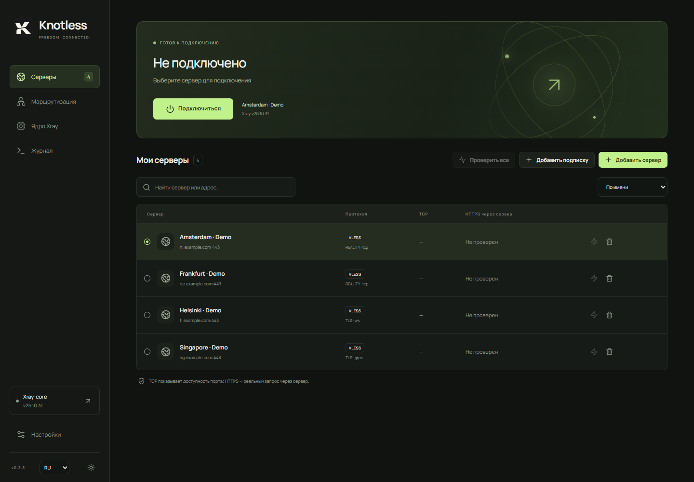

# Knotless

[Русский](README.md) · [English](README.en.md) · **简体中文**

我想做一个自己的 VPN 客户端，因为我不信任其他客户端，也厌倦了为了更新 Xray-core 而等待客户端发布新版本，而且我非常喜欢 RoutingA。Knotless 就这样诞生了：一款 Windows 客户端，可以独立选择内核版本，并使用 RoutingA 风格的路由规则。

界面使用 React / TypeScript，原生部分使用 Tauri 2 / Rust，支持俄语、英语和简体中文。

[下载 Windows x64 或 ARM64 版本](https://github.com/rusynergy/Knotless/releases/latest)



截图中的服务器均为虚构，使用 example.com 域名。当前未连接，也未执行网络测试。

## 功能

- 安装多个 Xray 版本，自由选择内核，无需等待客户端更新。
- 使用 TUN 处理设备流量，或使用本地 SOCKS5（`127.0.0.1:10808`）/ HTTP（`127.0.0.1:10809`）代理。
- 支持基础 RoutingA 语法：`default`、`domain`、`ip`、`port`、`network`；规则动作：`proxy`、`direct`、`block`。
- VLESS、TLS / REALITY，以及 TCP/RAW、WebSocket、gRPC、XHTTP、HTTPUpgrade 传输。
- HTTPS 订阅，支持标准 `x-hwid`（可按订阅关闭）、手动更新和定时更新。
- 分别测量 TCP 延迟和通过所选服务器发起 HTTPS 请求：端口可连接不代表 VPN 可以正常工作。
- DNS 支持 TCP 或 DoH，可选 Quad9（默认）、Google、Cloudflare、OpenDNS、Yandex 或自定义解析器。
- 实时流量统计与图表、连接健康检查、可选的 TUN 自动恢复、托盘菜单、浅色与深色主题。

## 0.3.7 版本

Knotless 在启动时、打开窗口前请求管理员权限，重启 Windows 后也同样生效。使用 TUN 无需再从设置中单独重启客户端。取消 UAC 后不会打开应用；已获得管理员权限的进程不会重复请求。

## 0.3.6 版本

DNS 设置新增“阻止 TUN 外的 DNS（WFP）”选项，用于兼容性测试。保护默认开启，旧配置也保持开启。关闭后需要保存并重新连接。TUN 内的 DNS 仍通过所选服务器发送，但 Windows 和其他程序可能在 VPN 之外发送查询。这是诊断选项，尚不能确认解决了 ARM64 的 DNS 故障。

## 0.3.5 版本

安装程序使用独立的退出助手。如果 Knotless 为运行 TUN 而以管理员身份启动，只有助手会请求 UAC 提权，安装仍保留在原用户的配置文件中。新版本客户端会收到正常退出请求；对于 0.3.4 及更早版本，助手先等待控制台 Xray 正常退出并清理 TUN，再结束正在更新的客户端实例。如果退出失败或取消 UAC，应用文件不会被替换。

## 0.3.4 版本

端口列表现在支持逗号后和范围分隔符两侧的空格。域名列表会编译为独立的 Xray 匹配项。不同类型的条件可以通过 `&&` 组合，例如：`network(udp) && port(596-599, 1400) -> proxy`。

## 0.3.3 版本

安装程序可直接覆盖更新现有的 NSIS 安装，保留服务器和设置。两种架构的安装包均内置 Xray **v26.10.31**，首次启动时自动选中，无需单独下载内核。每次构建都会获取最新稳定版 Xray 并验证 SHA-256。新的内置版本自动选中一次后，后续手动选择会被保留。

## 快速开始

1. 安装适合 Windows 架构的版本。更新前，请通过托盘菜单退出 Knotless。
2. 添加自己的 VLESS 链接或 HTTPS 订阅，然后选择服务器。
3. 执行服务器检测：TCP 检查端口连通性，HTTPS 通过服务器发送请求。
4. 在设置中选择本地代理或 TUN 模式。Knotless 会在启动时请求管理员权限，使用 TUN 无需单独重启。
5. 连接。本地代理模式下，需要在浏览器或其他应用中配置代理。

TUN 会遵循路由规则。使用 `default: proxy` 将互联网流量通过服务器转发；`direct` 表示直连，`block` 表示阻止匹配的流量。路由和 DNS 修改将在下次连接时生效。

```text
default: proxy
ip(geoip:private) -> direct
ip(91.108.56.0/22, 149.154.160.0/20) -> proxy
domain(domain: example.com) -> proxy
domain(geosite:category-ads) -> block
```

## 开发与构建

需要 Node.js 22+、Rust MSVC 工具链、Visual Studio C++ Build Tools 和 WebView2 Runtime。

```powershell
npm ci
.\scripts\dev.ps1
.\scripts\build.ps1 -Architecture all
```

也可使用 `-Architecture x64` 或 `-Architecture arm64` 单独构建。ARM64 还需要 Rust 目标 `aarch64-pc-windows-msvc`、ARM64 MSVC / Windows SDK 库，以及 PATH 中的 Clang。构建时需要访问 GitHub 以下载 Xray。

x64 安装包位于 `src-tauri/target/release/bundle/nsis/`，ARM64 安装包位于 `src-tauri/target/aarch64-pc-windows-msvc/release/bundle/nsis/`；若设置了 `CARGO_TARGET_DIR`，则使用对应目录。`npm run dev` 可在浏览器中预览界面，但不能使用原生功能。

```powershell
npm test
npm run build
cargo test --manifest-path src-tauri/Cargo.toml
```

## 当前限制

目前是开发版本，安装程序尚未进行数字签名。ARM64 已通过交叉编译及安装包内二进制文件的架构检查，但尚未在 ARM 设备上测试。完整 RoutingA 兼容性、可视化规则编辑器、Windows 开机自启、持续生效的断网保护、自动设置系统 HTTP 代理和客户端自动更新尚未实现。

配置和订阅地址在本地以未加密形式保存。HTTPS 订阅不跟随重定向，请使用最终地址。定时更新仅在 Knotless 运行期间执行。HTTPS 检测成功只代表检测时配置的目标地址可用，并不保证所有网站、UDP 或系统路由正常。为提高兼容性，默认禁用 IPv6 DNS 响应；浏览器自己的 DoH 可能绕过这一设置。

Xray 内核保存在 `%LOCALAPPDATA%/app.knotless.desktop/cores`（x64）或 `cores-arm64`（ARM64）。Wintun 的分发许可证见 [WINTUN-LICENSE.txt](src-tauri/resources/WINTUN-LICENSE.txt)，内置 Xray 包含其许可证。详细实现说明和可选集成测试命令见[俄语文档](README.md)。
